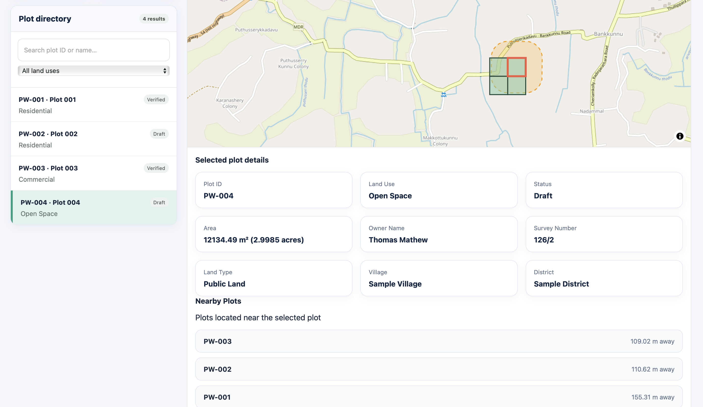

# PlotWise — Smart Land Plot Explorer 🗺️

An interactive, database-connected Web GIS application for visualizing, exploring, managing, and analyzing land parcel information using modern web mapping technologies and spatial databases.

🌐 **Live Demo:** https://annascaria111.github.io/plotwise-gis/

📂 **GitHub Repository:** https://github.com/annascaria111/plotwise-gis

---

## 📌 Project Overview

PlotWise is a web-based Geographic Information System (GIS) application designed to explore and manage land plot information through an interactive map interface.

The application connects to a Supabase-hosted PostgreSQL database with PostGIS to retrieve plot attributes and spatial geometries.

Users can visualize plot boundaries, search and filter plots, inspect property information, calculate approximate land areas, generate buffer zones, and identify nearby plots.

The application also includes an administrator dashboard for managing plot records through authenticated access.

## ✨ Key Features

### 🗺️ GIS Map Explorer
- Interactive map with polygon-based plot visualization
- GeoJSON FeatureCollection handling
- Plot selection and boundary highlighting
- Map navigation and plot details
- Search plots by ID or name
- Filter plots by land use
- Approximate area calculation in square meters and acres

### 📍 Spatial Analysis
- Buffer zone visualization using PostGIS
- Nearby plot discovery
- Distance calculation between plots
- Spatial geometry retrieval from PostgreSQL

### 🔐 Admin Dashboard
- Admin authentication using Supabase Auth
- Role-based administrator access
- View and manage plot records
- Add new plots using GeoJSON Polygon data
- Edit plot names, land use, and status
- Delete plot records
- Dashboard statistics for total, verified, and draft plots
- Database-backed plot management

## 🛠️ Technologies Used

| Technology | Purpose |
|---|---|
| HTML5 | Application structure |
| CSS3 | User interface design |
| JavaScript | Application logic |
| MapLibre GL JS | Interactive map visualization |
| GeoJSON | Spatial data exchange |
| Supabase | Backend services and API |
| Supabase Auth | Administrator authentication |
| PostgreSQL | Relational database |
| PostGIS | Spatial data storage and analysis |
| SQL | Database queries and spatial functions |

## 🏗️ System Architecture

PlotWise follows a database-connected Web GIS architecture.

1. **Frontend:** HTML, CSS, and JavaScript provide the application interface.
2. **Map Visualization:** MapLibre GL JS displays interactive maps and plot geometries.
3. **Backend API:** Supabase provides API access to database records and functions.
4. **Authentication:** Supabase Auth manages administrator sign-in.
5. **Spatial Database:** PostgreSQL with PostGIS stores plot attributes and polygon geometries and performs spatial operations.

### Data Flow

```text
       User Interface
             |
             v
      HTML / CSS / JS
             |
             v
       MapLibre GL JS
             |
             v
        Supabase API
          /       \
         v         v
    Supabase Auth  PostgreSQL
                       |
                       v
                    PostGIS
                       |
                       v
             GeoJSON / Spatial Results
                       |
                       v
                Interactive Map
```

## 🗄️ Database Integration

PlotWise uses Supabase-hosted PostgreSQL with the PostGIS extension.

The `public.plots` table stores information such as:

- Plot ID and plot name
- Land-use classification
- Plot status
- Owner information
- Survey number
- Land type
- Village and district
- Polygon geometries using `geometry(Polygon, 4326)`

### Spatial Database Functions

| Function | Purpose |
|---|---|
| `get_plots_geojson()` | Retrieves plot geometries and attributes as a GeoJSON FeatureCollection |
| `get_plot_buffer(double precision, text)` | Generates a buffer around a selected plot |
| `get_nearby_plots(text)` | Retrieves nearby plots and their distances |
| `add_plot_from_geojson(text, text, text, text, jsonb)` | Adds a plot using GeoJSON polygon geometry |

### Spatial Operations

The application uses PostGIS functions including:

- `ST_AsGeoJSON`
- `ST_Buffer`
- `ST_GeomFromGeoJSON`
- `ST_IsValid`
- `ST_Transform`

These operations support geometry conversion, validation, buffer generation, and spatial analysis.

## 🔐 Security and Access Control

- Supabase authentication for administrator sign-in
- Administrator roles stored in a `user_roles` table
- Row Level Security (RLS) policies for plot management
- Public read access to plot information
- Administrator-only insert, update, and delete permissions

**Security note:** The frontend uses a Supabase publishable key. Secret and service-role keys must never be exposed in client-side code.

## 🗂️ Project Structure

```text
plotwise-gis/
│
├── data/
│   └── plots.geojson
│
├── screenshots/
│   └── plotwise-dashboard.png
│
├── sql/
│   └── schema.sql
│
├── index.html
├── README.md
└── .gitignore
```

## 🚀 Getting Started

### 1. Clone the Repository

```bash
git clone https://github.com/annascaria111/plotwise-gis.git
```

### 2. Open the Project

Open the project folder in Visual Studio Code.

### 3. Configure Supabase

Configure your Supabase project URL and publishable API key in the application configuration.

### 4. Configure the Database

Ensure your Supabase project has:

- PostgreSQL database
- PostGIS extension
- Required `plots` and `user_roles` tables
- Required database functions
- Appropriate RLS policies and permissions

Refer to the SQL files and database configuration used by the project.

### 5. Run the Application

Use the VS Code Live Server extension to launch `index.html` locally.

## 📊 Sample Dataset

The demonstration includes four sample land plots:

- PW-001
- PW-002
- PW-003
- PW-004

The administrator can add additional plot records through the dashboard.

**Data Disclaimer:** All plot boundaries, ownership information, and property attributes are synthetic practice data. They are not verified cadastral records or legal survey boundaries and must not be used for actual land transactions.

## 🔮 Future Enhancements

- Interactive map-based polygon drawing and editing
- Advanced spatial query tools
- Plot export in GeoJSON format
- Improved reporting and analytics
- Integration with verified land survey datasets

## 📸 Project Screenshot



## 👩‍💻 Developer

**ANNA SCARIA**

B.Tech Computer Science and Design Engineering Graduate (2026)

- **GitHub:** https://github.com/annascaria111
- **LinkedIn:** https://www.linkedin.com/in/anna-scaria-204a8a374/

---

*PlotWise — Explore Land. Understand Space. Make Better Decisions.*