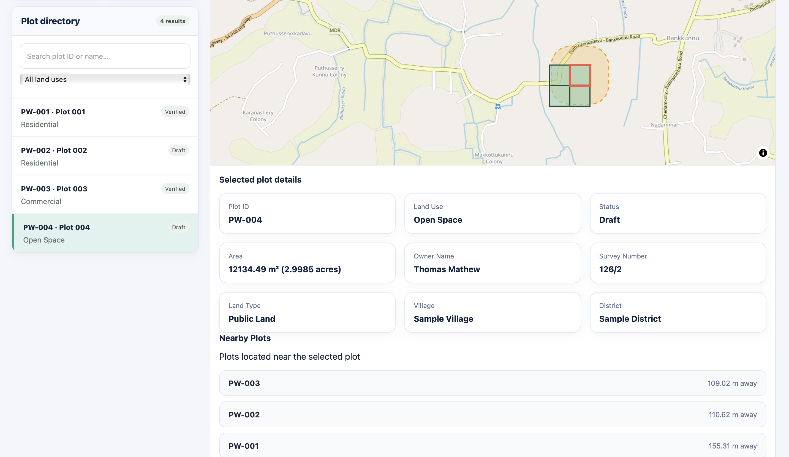

# PlotWise — Smart Land Plot Explorer 🗺️

An interactive, database-connected GIS application for visualizing, exploring, and analyzing land parcel information using web mapping technologies and spatial databases.

## 🌐 Live Demo

**[Open PlotWise GIS Explorer](https://annascaria111.github.io/plotwise-gis/)**

## 📌 Project Overview

PlotWise is a web-based Geographic Information System (GIS) application that allows users to explore land plots through an interactive map.

The application retrieves plot attributes and spatial geometries from a Supabase-hosted PostgreSQL database with PostGIS. Users can visualize plot boundaries, search and filter plots, inspect property information, calculate approximate land areas, generate buffer zones, and discover nearby plots.

## ✨ Features

- Interactive GIS map with polygon-based plot visualization
- Database-driven plot directory
- Search plots by plot ID or name
- Filter plots by land use
- Select and highlight individual plots
- View plot attributes and ownership information
- Approximate area calculation in square meters and acres
- Buffer zone visualization using PostGIS
- Nearby plot discovery with distance calculations
- GeoJSON FeatureCollection generation from database geometries
- Supabase API integration

## 🛠️ Technologies Used

| Technology | Purpose |
|---|---|
| HTML5 | Application structure |
| CSS3 | User interface design |
| JavaScript | Application logic |
| MapLibre GL JS | Interactive map visualization |
| GeoJSON | Spatial data exchange format |
| Supabase | Backend services and database API |
| PostgreSQL | Relational database |
| PostGIS | Spatial data storage and analysis |
| SQL | Database queries and spatial functions |

## 🏗️ System Architecture

The application follows a database-connected web GIS architecture.

1. **Frontend:** HTML, CSS and JavaScript provide the user interface and application functionality.
2. **Map visualization:** MapLibre GL JS displays interactive maps and plot geometries.
3. **Backend API:** Supabase provides API access to PostgreSQL database functions.
4. **Spatial database:** PostgreSQL with PostGIS stores plot attributes and polygon geometries and performs spatial operations.

### Data Flow

`MapLibre Frontend → Supabase API → PostgreSQL + PostGIS`

Database functions return GeoJSON data and spatial-analysis results to the frontend.

## 🗄️ Database Integration

PlotWise uses Supabase-hosted PostgreSQL with the PostGIS extension.

The `public.plots` table stores:

- Plot identifiers and names
- Land-use classifications
- Plot status
- Ownership and survey information
- Polygon geometries using `geometry(Polygon, 4326)`

### Spatial Database Functions

| Function | Purpose |
|---|---|
| `get_plots_geojson()` | Retrieves plot geometries and attributes as a GeoJSON FeatureCollection |
| `get_plot_buffer(double precision, text)` | Generates a buffer around a selected plot |
| `get_nearby_plots(text)` | Retrieves nearby plots and their distances |

Spatial operations use PostGIS functions such as `ST_AsGeoJSON`, `ST_Buffer`, and spatial geometry transformations.

## 🗺️ GIS Functionalities

- Polygon-based land parcel visualization
- GeoJSON FeatureCollection handling
- Interactive plot selection and map navigation
- Approximate polygon area calculation
- Buffer zone generation
- Nearby plot identification and distance calculation
- Spatial data retrieval from PostgreSQL/PostGIS

## 🗂️ Project Structure

```text
plotwise-gis/
│
├── data/
│   └── plots.geojson
│
├── screenshots/
│   └── plotwise-dashboard.png
│
├── sql/
│   └── schema.sql
│
├── index.html
├── README.md
└── .gitignore
```

## 🚀 Getting Started

### 1. Clone the repository

```bash
git clone https://github.com/annascaria111/plotwise-gis.git
```

### 2. Open the project

Open the project folder in Visual Studio Code.

### 3. Configure Supabase

Configure your Supabase project URL and publishable API key in the application configuration.

Never expose a Supabase secret key or service-role key in frontend code.

### 4. Configure the database

Ensure the following are configured in your Supabase project:

- PostgreSQL database and PostGIS extension
- Required `plots` table and spatial index
- Required database functions
- Appropriate API permissions and security policies

The SQL schema is provided in the `sql/` directory.

### 5. Run the application

Use the VS Code Live Server extension to launch `index.html` locally.

## 📊 Sample Dataset

The demonstration currently contains four sample land plots:

- PW-001
- PW-002
- PW-003
- PW-004

**Data disclaimer:** All plot boundaries, ownership information, and property attributes are synthetic practice data. They are not verified cadastral records or legal survey boundaries and must not be used for actual land transactions.

## 🔮 Future Enhancements

- User authentication and role-based access control
- Plot boundary editing and management
- Advanced spatial analysis tools
- Improved reporting and analytics
- Integration with verified land survey datasets

## 👩‍💻 Developer

**Anna Scaria**

B.Tech Computer Science and Design Engineering Graduate (2026)

- GitHub: [annascaria111](https://github.com/annascaria111)
- LinkedIn: [Anna Scaria](https://www.linkedin.com/in/anna-scaria-204a8a374/)

## 📸 Project Screenshot



---

*PlotWise — Explore Land. Understand Space. Make Better Decisions.*
